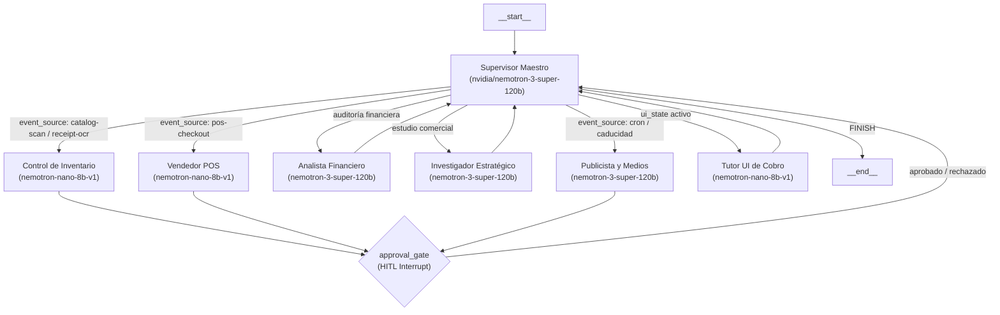

# Roles y Especialidades de los Agentes — Tiendita IA

Este repositorio implementa un ecosistema comercial multimodal basado en **LangGraph** y tecnologías **NVIDIA (NIM / NeMo)**, compuesto por **1 Agente Supervisor Maestro** y **6 Agentes Especialistas**.

---

## 1. Supervisor Maestro (`agents/supervisor.py`)
- **Modelo:** `nvidia/nemotron-3-super-120b-a12b`
- **Misión:** Director de orquesta central. Enruta dinámicamente mediante **razonamiento estructurado puro** (`with_structured_output`) sin condicionales por palabras clave.
- **Capacidades:** Control estricto `iteration_count <= 6`, soporte para encadenamiento compuesto de especialistas (`compound_chain`).

## 2. Control de Inventario y Auditoría (`agents/control.py`)
- **Modelo:** `nvidia/llama-3.1-nemotron-nano-8b-v1` (apto para adaptadores LoRA de NeMo Customizer)
- **Misión:** Procesamiento de fotos de catálogo (`/catalog-scan`), clasificación estricta de tickets (`/receipt-ocr`) en `inversion_inventario` vs `gasto_operativo` y alertas de desabasto/caducidad.
- **HITL:** Conectado a `approval_gate` ante altas de catálogo o modificaciones de stock.

## 3. Vendedor POS de Mostrador (`agents/vendedor.py`)
- **Modelo:** `nvidia/llama-3.1-nemotron-nano-8b-v1`
- **Misión:** Identificación visual de productos en mostrador (`/pos-checkout`), cotización contra base de datos, liquidación de carritos y recomendaciones de **Upselling** para elevar el ticket promedio.
- **Seguridad:** Enmascaramiento obligatorio del costo unitario (`prevent_cost_leakage`).

## 4. Analista Financiero (`agents/analista.py`)
- **Modelo:** `nvidia/nemotron-3-super-120b-a12b`
- **Misión:** Rol estricto de **Solo Lectura**. Cálculo de flujo de caja neto, análisis de margen bruto por SKU y rotación de mercancía para auditorías ejecutivas.

## 5. Investigador Comercial y Estratégico (`agents/investigador.py`)
- **Modelo:** `nvidia/nemotron-3-super-120b-a12b`
- **Misión:** Elaboración de estudios de viabilidad y expansión comercial estructurados rigurosamente en **9 secciones obligatorias** (`identificacion_sector`, `mercado_tendencias`, `clientes`, `problemas`, `soluciones`, `hipotesis`, `objetivos`, `impacto`, `hallazgos`).

## 6. Publicista y Creador de Campañas (`agents/publicista.py`)
- **Modelo:** `nvidia/nemotron-3-super-120b-a12b`
- **Misión:** Generación de copys comerciales persuasivos, llamados a la acción (CTAs) y especificaciones técnicas de **video vertical 9:16 de 5 segundos** ante caducidades inminentes o sobrestock.
- **HITL:** Conectado a `approval_gate` antes de difundir cualquier campaña.

## 7. Tutor UI de Pagos Digitales (`agents/tutor_ui.py`)
- **Modelo:** `nvidia/llama-3.1-nemotron-nano-8b-v1`
- **Misión:** Copiloto de pantalla en terminales de cobro. Razonamiento puro sobre `ui_state` con límite inquebrantable de **máximo 2 oraciones accionables** sin rodeos técnicos.
