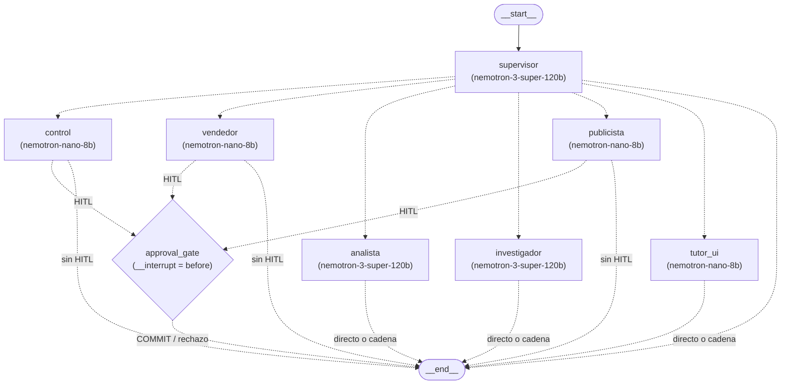

# Guía para Agentes de IA — Tiendita IA (`enjambre_agentes`)

Este repositorio implementa un ecosistema comercial multimodal en **LangGraph** con tecnologías **NVIDIA (NIM / NeMo)**, conectado en vivo a **PostgreSQL (`tiendita-db` + `pgvector`)** y a un **RAG Dual especializado en pagos digitales de México (CoDi, SPEI, DiMo)**.

> **Documentación detallada modular (leer según tarea):**
> - Índice maestro e invariantes: [`docs/README.md`](./docs/README.md)
> - Grafo LangGraph, estado y HITL: [`docs/01_ARQUITECTURA_Y_ORQUESTACION.md`](./docs/01_ARQUITECTURA_Y_ORQUESTACION.md)
> - Fichas técnicas de los 7 agentes: [`docs/02_CATALOGO_AGENTES.md`](./docs/02_CATALOGO_AGENTES.md)
> - Inventario de `@tool`, SQL y MCP: [`docs/03_CATALOGO_TOOLS_Y_BD.md`](./docs/03_CATALOGO_TOOLS_Y_BD.md)
> - Memoria multicapa y RAG CoDi/SPEI/DiMo: [`docs/04_MEMORIA_Y_RAG_PAGOS.md`](./docs/04_MEMORIA_Y_RAG_PAGOS.md)
> - Stack NVIDIA (NIM/NeMo) y Resiliencia: [`docs/05_STACK_NVIDIA_Y_RESILIENCIA.md`](./docs/05_STACK_NVIDIA_Y_RESILIENCIA.md)
> - Operación CLI/API y guía de extensión: [`docs/06_OPERACION_CLI_API_Y_EXTENSION.md`](./docs/06_OPERACION_CLI_API_Y_EXTENSION.md)

---

## Reglas Críticas del Repositorio
1. **Razonamiento puro:** prohibido el enrutamiento o selección de herramientas por palabras clave (`if "palabra" in query`). Todo se resuelve vía `with_structured_output` y *Tool Calling* nativo.
2. **Intocables:** no modificar `Referencias/` ni los scripts SQL en `../back/db/init/`.
3. **100% NVIDIA por defecto + overrides en runtime:** todos los agentes invocan `get_llm(role="<rol>")`, resolviendo desde `ACTIVE_AGENT_BRAINS` con rescate silencioso `.with_fallbacks()` + Circuit Breaker (`ResilientChatModel`).
4. **PostgreSQL real sin mocks operativos:** usar `_get_connection()` de `tools/db_client.py`, vistas oficiales (`v_*`) y `registrar_venta(jsonb)`.
5. **Contratos públicos de `agents/graph.py`:** preservar `run_orchestration`, `run_orchestration_stream`, `resume_orchestration` y `get_graph_state`.

---

## Mapa Rápido de los 7 Agentes

| Rol | Archivo | Modelo NVIDIA Default | Rol Operativo | HITL |
|---|---|---|---|---|
| `supervisor` | `agents/supervisor.py` | `nvidia/nemotron-3-super-120b-a12b` | Director de orquesta (`SupervisorDecision`, `compound_chain` sanitizado, tope `iteration_count <= 6`). | No |
| `control` | `agents/control.py` | `nvidia/llama-3.1-nemotron-nano-8b-v1` | Catálogo visual, OCR de tickets (`inversion_inventario` vs `gasto_operativo`), altas/stock y alertas de caducidad. | **Sí** |
| `vendedor` | `agents/vendedor.py` | `nvidia/llama-3.1-nemotron-nano-8b-v1` | Mostrador POS, carritos, `registrar_venta()`, upselling real (`v_coocurrencia`), reglas CoDi/SPEI/DiMo y máscara de costos. | **Sí** |
| `analista` | `agents/analista.py` | `nvidia/nemotron-3-super-120b-a12b` | Auditoría financiera **Solo Lectura** (`v_flujo_caja`, `v_margen_producto`, rotación, ventas). | No |
| `investigador` | `agents/investigador.py` | `nvidia/nemotron-3-super-120b-a12b` | Investigación web (Tavily + scraping) + memoria de reportes previos → `StrategicReport` de **9 secciones** indexado en FAISS. | No |
| `publicista` | `agents/publicista.py` | `nvidia/llama-3.1-nemotron-nano-8b-v1` | Campañas de rescate sobre lotes reales de `v_por_caducar`, CTA y prompt de video vertical 9:16 (5 s). | **Sí** |
| `tutor_ui` | `agents/tutor_ui.py` | `nvidia/llama-3.1-nemotron-nano-8b-v1` | Copiloto de pantalla para pagos digitales **CoDi / SPEI / DiMo** respaldado por RAG oficial; máximo **2 oraciones accionables**. | No |

---

## Diagrama de Flujo del Grafo

*(Si `compound_chain` contiene especialistas adicionales pendientes, el router regresa a `supervisor` antes de finalizar en `END`. Ver diagrama autogenerado completo en [`ARCHITECTURE_GRAPH.md`](./ARCHITECTURE_GRAPH.md).)*
