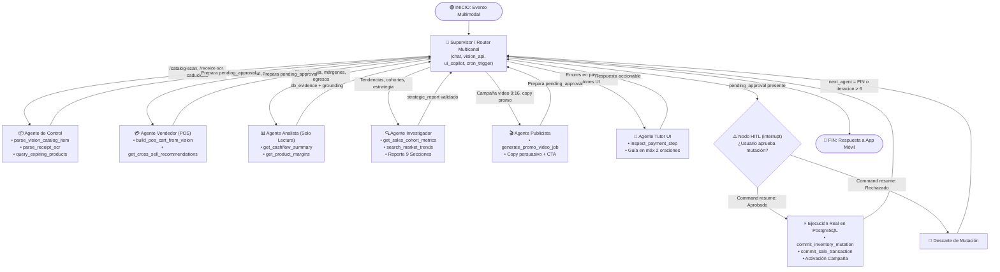

# 🛒 Ecosistema Multiagente Comercial Multimodal
### *Dashboard Ejecutivo + Chatbot Multiagente + Copiloto de Pagos UI + API de Visión Artificial*

---

## 📌 1. Visión General y Arquitectura

Este módulo implementa un **Ecosistema Multiagente Comercial** orquestado en **LangGraph** (Python 3.11+, Pydantic v2). Conecta directamente la operación en tienda física con la aplicación móvil ejecutiva mediante visión por computadora, pasarelas de pago asistidas, análisis financiero en tiempo real y generación publicitaria automatizada.

### Principios Arquitectónicos:
1. **Fábrica Centralizada Desacoplada (`models.py`)**: Soporte nativo para NVIDIA NIM, Google Gemini, Groq y Ollama Local utilizando exclusivamente variables de entorno (`os.getenv`).
2. **Gobernanza Determinista Anti-Alucinaciones (`guards.py`)**: Verificación matemática estricta de afirmaciones monetarias contra la evidencia real de PostgreSQL (`enforce_db_grounding`) y validación estructural del reporte de 9 secciones (`validate_strategic_report`).
3. **Control de Ciclos Acotados**: Salvaguarda rígida que fuerza la terminación en `FIN` si `iteration_count >= 6`.
4. **Human-in-the-Loop (HITL)**: Interrupción determinista (`interrupt()`) antes de ejecutar mutaciones en base de datos (`commit_inventory_mutation`, `commit_sale_transaction`, activación de promociones).
5. **Protocolo MCP (Model Context Protocol)**: Exportación estándar de las **17 herramientas comerciales** tipadas en JSON Schema.

---

## 🏛️ 2. Diagrama de Topología del Grafo (6 Especialistas + HITL)



---

## 🗄️ 3. Esquema de Base de Datos PostgreSQL y Contratos de Entrada

### Tablas de Referencia en PostgreSQL:
- **`productos`**: `(id, sku, nombre, categoria, precio_venta, costo_unitario, stock_actual, stock_minimo, atributos_visuales)`
- **`lotes_inventario`**: `(id, producto_id, cantidad, fecha_caducidad, estado)`
- **`ventas`**: `(id, fecha, total, metodo_pago, origen_vision)`
- **`detalle_ventas`**: `(id, venta_id, producto_id, cantidad, precio_unitario, subtotal)`
- **`movimientos_financieros`**: `(id, tipo['gasto_operativo'|'inversion_inventario'], proveedor, monto_total, fecha, url_ticket, datos_ocr_json)`
- **`campanas_promocionales`**: `(id, producto_id, motivo, copy_texto, video_prompt, video_url, estado_aprobacion)`

### Contratos JSON de Entrada:

#### A. Contrato `vision_payload`:
```json
{
  "endpoint": "/catalog-scan | /pos-checkout | /receipt-ocr",
  "items": [
    {
      "sku": "LALA-1L",
      "nombre": "Leche Entera Lala 1L",
      "cantidad": 2,
      "precio_unitario": 28.50,
      "atributos": {"color": "azul/blanco", "empaque": "tetrapack"}
    }
  ],
  "proveedor": "Distribuidora de Lácteos S.A.",
  "total": 57.00,
  "tipo_movimiento": "inversion_inventario",
  "confianza_global": 0.98
}
```

#### B. Contrato `ui_state`:
```json
{
  "pantalla": "PagoSPEI",
  "paso_actual": "ingreso_clabe",
  "campos_vacios": ["clabe_interbancaria"],
  "error_visible": "La cuenta CLABE debe tener 18 dígitos numéricos.",
  "intentos": 2
}
```

---

## 🛠️ 4. Catálogo de los 6 Kits de Herramientas Tipadas (17 Herramientas + MCP)

| Kit | Herramienta | Firma / Comportamiento |
|---|---|---|
| **CONTROL** | `parse_vision_catalog_item` | Valida `/catalog-scan` y coteja si el SKU existe en `productos`. |
| **CONTROL** | `parse_receipt_ocr` | Clasifica tickets `/receipt-ocr` en `inversion_inventario` vs `gasto_operativo`. |
| **CONTROL** | `query_expiring_products` | Consulta `lotes_inventario` a caducar (≤ 3 días) o con existencias ≤ stock mínimo. |
| **CONTROL** | `commit_inventory_mutation` | Ejecuta INSERT/UPDATE de inventario o comprobantes tras confirmación HITL. |
| **VENDEDOR** | `build_pos_cart_from_vision` | Cruza ítems de `/pos-checkout` con el catálogo, verifica stock y calcula subtotales. |
| **VENDEDOR** | `get_cross_sell_recommendations` | Sugiere productos complementarios de alta co-ocurrencia para venta de impulso. |
| **VENDEDOR** | `commit_sale_transaction` | Registra en `ventas` y `detalle_ventas` y descuenta existencias en `productos`. |
| **ANALISTA** | `get_cashflow_summary` | *(Solo lectura)* Cruza ingresos de ventas vs egresos operativos e inventario. |
| **ANALISTA** | `get_product_margins` | *(Solo lectura)* Calcula margen bruto ($ y %) y rotación por SKU o categoría. |
| **INVESTIGADOR** | `get_sales_cohort_metrics` | Obtiene ticket promedio, horarios pico y productos ancla desde la BD histórica. |
| **INVESTIGADOR** | `search_market_trends` | Consulta tendencias comerciales externas vía Tavily Search API o fallback estructurado. |
| **PUBLICISTA** | `generate_promo_video_job` | Despacha prompt vertical 9:16 (5s) a API de video y registra borrador de campaña. |
| **TUTOR_UI** | `inspect_payment_step` | Diagnostica pantallas de pago móvil (SPEI, tarjeta, QR) y emite instrucción en ≤ 2 oraciones. |

Todas las herramientas se exportan automáticamente en formato **MCP JSON Schema** mediante `to_mcp_tool_definitions()`.

---

## 🤖 5. Integración del Asistente de Catálogo (`assistant/`)

El módulo incorpora el dataset de entrenamiento y las 4 herramientas de gestión operativa de la tienda generadas en `assistant/`, ahora disponibles directamente desde `control_node`:

### System Prompt del Asistente
El asistente responde **siempre** en JSON estructurado:
```json
{"tool": "<nombre o null>", "args": {"...": "..."}, "respuesta": "<texto breve en español>"}
```

### 4 Herramientas de Catálogo (integradas en `CONTROL_TOOLS`)

| Herramienta | Descripción | Trigger de ejemplo |
|---|---|---|
| `consultar_inventario` | Consulta existencias y precio de un producto o el catálogo completo | "¿Cuánto me queda de la Coca?" |
| `actualizar_precio` | Actualiza el precio de venta con confirmación HITL | "Sube la Leche a $31.50" |
| `ajustar_stock` | Registra entrada, salida o merma de existencias | "Llegaron 10 de Bimbo" / "Se echaron a perder 2 yogurts" |
| `crear_producto` | Da de alta un nuevo producto con precio y stock inicial | "Dame de alta Mazapán a $5, tengo 24" |

### Alias Coloquiales Mexicanos
La función `find_product_by_name_or_alias()` resuelve nombres coloquiales sobre los 17 productos del mock:
- `"la coca"` → Coca-Cola 600 ml  
- `"blanquillos"` → Huevo Blanco 12 pzas  
- `"la boing"` → Jugo Boing 500 ml  
- `"sabritas"` → Papas Sabritas 45 g  

### Dataset de Entrenamiento
El dataset JSONL (`assistant/data/train.jsonl`, 961 ejemplos) se indexa automáticamente por categoría en `FewShotRetriever` y se usa como few-shots para el `control_node`:

```bash
# Regenerar el dataset de entrenamiento (asistente LoRA)
cd /home/m4r10/Documents/tiendita-ia
python assistant/gen_data.py

# Evaluar el asistente contra el conjunto de prueba
python assistant/eval.py
```

### Categorías del Dataset
`crear_completo`, `precio`, `consulta_producto`, `stock`, `fuera_de_alcance` (y más).

> [!IMPORTANT]
> Las consultas `fuera_de_alcance` (clima, chistes, recetas, noticias, etc.) son interceptadas por el supervisor **antes** de consumir una iteración, retornando `tool: null` y un mensaje de cortesía.

---

## 💡 5. Ejemplos Funcionales de Uso### 1. Punto de Venta por Cámara (`/pos-checkout`) + Flujo HITL:
```python
from enjambre_agentes import run_orchestration, resume_orchestration

# 1. Llega evento de cámara del punto de venta
estado_inicial = run_orchestration(
    thread_id="caja_pos_001",
    event_source="vision_api",
    vision_payload={
        "endpoint": "/pos-checkout",
        "items": [
            {"sku": "LALA-1L", "cantidad": 2},
            {"sku": "BIMB-BLAN", "cantidad": 1}
        ],
        "confianza_global": 0.99
    }
)

# El grafo entra en pausa por interrupt() y solicita aprobación en la app:
print("Acción pendiente:", estado_inicial["pending_approval"]["summary"])
# -> "Cobro de 2 productos por un total de $99.00."

# 2. El operador en caja confirma la transacción en su pantalla móvil:
estado_final = resume_orchestration(
    thread_id="caja_pos_001",
    approved=True
)
print("Resultado:", estado_final["messages"][-1].content)
# -> "Venta confirmada y registrada en BD: Venta #4 confirmada. Stock descontado exitosamente."
```

### 2. Clasificación de Factura / Ticket con OCR (`/receipt-ocr`):
```python
resultado = run_orchestration(
    thread_id="ocr_ticket_002",
    event_source="vision_api",
    vision_payload={
        "endpoint": "/receipt-ocr",
        "proveedor": "CFE Suministrador de Servicios Básicos",
        "items": [{"descripcion": "Energía eléctrica local", "subtotal": 1150.00}],
        "total": 1150.00,
        "tipo_movimiento": "gasto_operativo"
    }
)

# El Agente de Control clasifica el comprobante como gasto operativo y solicita confirmación:
print("Pendiente:", resultado["pending_approval"]["summary"])
# -> "Registro de comprobante de CFE por $1,150.00 (gasto_operativo)."
```

### 3. Copiloto Tutor UI de Pagos (Máximo 2 oraciones accionables):
```python
resultado_ui = run_orchestration(
    thread_id="copiloto_ui_003",
    event_source="ui_copilot",
    ui_state={
        "pantalla": "PagoSPEI",
        "paso_actual": "ingreso_clabe",
        "campos_vacios": ["clabe_interbancaria"],
        "error_visible": "CLABE interbancaria de 18 dígitos requerida",
        "intentos": 2
    }
)

print(resultado_ui["messages"][-1].content)
# -> "Verifica que tu cuenta CLABE contenga exactamente 18 dígitos sin espacios ni guiones. Pégala en el campo 'CLABE Interbancaria' y pulsa el botón 'Confirmar Transferencia'."
```

### 4. Inteligencia de Mercado (Reporte de 9 Secciones del Investigador):
```python
resultado_inv = run_orchestration(
    thread_id="reporte_estrategico_004",
    event_source="chat",
    query="Genera el reporte estratégico de mercado para abarrotes de conveniencia"
)

reporte = resultado_inv["strategic_report"]
# Contiene exactamente las 9 claves obligatorias:
# 1. identificacion_sector
# 2. mercado_tendencias
# 3. clientes
# 4. problemas
# 5. soluciones
# 6. hipotesis
# 7. objetivos
# 8. impacto
# 9. hallazgos
```

---

## 🚀 6. Instalación y Configuración

### Requisitos Previos
- Python 3.11 o superior
- **uv** (gestor de dependencias ultrarrápido): `pip install uv` o desde https://github.com/astral-sh/uv
- API key de al menos un proveedor LLM (NVIDIA NIM, Gemini, Groq, Cohere o Ollama local)

### Paso 1: Clonar y navegar al directorio
```bash
cd tiendita-ia/enjambre_agentes
```

### Paso 2: Configurar variables de entorno
```bash
# Copiar el archivo de ejemplo
cp .env.example .env

# Editar .env con tus API keys reales
nano .env  # o usa tu editor favorito
```

**Mínimo requerido** para comenzar:
- `DEFAULT_LLM_PROVIDER=NVIDIA` (o Gemini, Groq, Cohere, Ollama)
- API key del proveedor elegido (ej: `NVIDIA_API_KEY=nvapi-...`)

### Paso 3: Instalar dependencias con uv
```bash
# Sincronizar el entorno virtual desde pyproject.toml
uv sync

# O instalar desde requirements.txt
uv pip install -r requirements.txt
```

### Paso 4: Verificar instalación
```bash
# Probar la suite de tests
uv run python test_suite.py

# Si todo está bien, verás: "✓ [X/X] tests pasaron exitosamente"
```

---

## 🎮 7. Ejecución

### Opción A: CLI Interactivo (Recomendado para pruebas)
```bash
# Ejecutar el chatbot de terminal
uv run python cli_tester.py

# O con un proveedor específico
uv run python cli_tester.py --provider Gemini --model gemini-2.5-flash

# O con Ollama local
uv run python cli_tester.py --provider Ollama --model nemotron-3-nano:30b
```

**Comandos disponibles en el CLI:**
- `/pos` — Simula cobro POS por cámara
- `/ticket` — Simula lectura de ticket OCR
- `/pago` — Simula pantalla de pago con error
- `/estado` — Muestra el estado interno de la sesión
- `/ayuda` — Lista todos los comandos
- `/salir` — Cierra el CLI

### Opción B: API REST con FastAPI
```bash
# Levantar el servidor en http://localhost:8000
uv run uvicorn api:app --reload --port 8000

# Abrir la documentación interactiva Swagger UI
# Navega a: http://localhost:8000/docs
```

**Endpoints disponibles:**
- `POST /orchestrate` — Ejecución síncrona (batch)
- `POST /orchestrate/stream` — Streaming SSE en tiempo real
- `POST /orchestrate/resume` — Reanudación HITL
- `GET /threads/{thread_id}/state` — Inspección de estado
- `GET /mcp/tools` — Exportación JSON Schema MCP
- `GET /health` — Healthcheck del sistema

### Opción C: Uso Programático
```python
from enjambre_agentes import run_orchestration, resume_orchestration

# Ejemplo: Consulta de inventario
resultado = run_orchestration(
    query="¿Cuánto me queda de Coca-Cola?",
    thread_id="consulta_001"
)

print(resultado["messages"][-1].content)
```

---

## 🛠️ 8. Gestión de Dependencias con uv

```bash
# Añadir un nuevo paquete
uv add <nombre-paquete>

# Actualizar todas las dependencias
uv sync --upgrade

# Exportar requirements.txt actualizado
uv pip freeze > requirements.txt

# Ver árbol de dependencias
uv pip tree
```

---

## 🧪 9. Validación y Suite de Pruebas Unitarias

El módulo cuenta con una suite completa en `test_suite.py` que valida:
1. Contratos de datos Pydantic v2.
2. Tipado y exportación JSON Schema de las **17 herramientas** MCP (8 control + 3 vendedor + 2 analista + 2 investigador + 1 publicista + 1 tutor_ui).
3. Validación determinista de Grounding (`guards.py`).
4. Inyección Few-Shot para los 5 roles (`few_shot_retriever.py`).
5. Punto de venta por cámara (`/pos-checkout`) con interrupción HITL.
6. Clasificación de tickets OCR (`/receipt-ocr`) y registro en finanzas.
7. Regla de máximo 2 oraciones accionables del Tutor UI.
8. Análisis financiero y reporte estratégico de 9 secciones del Investigador.
9. Integración `assistant/`: 4 herramientas de catálogo + alias coloquiales + guard `fuera_de_alcance`.

```bash
# Ejecución completa con uv
uv run python test_suite.py
```
