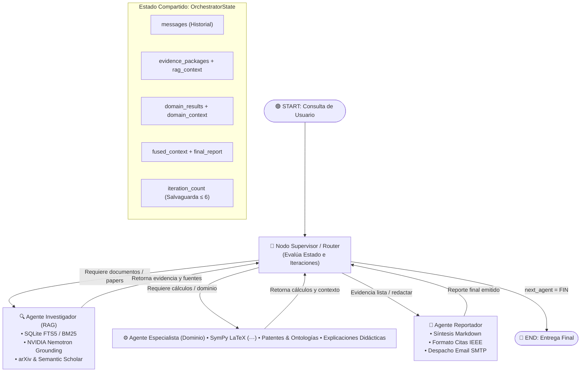

# 🧠 Plantilla Unificada de Orquestación Multiagente en LangGraph
### *Arquitectura Jerárquica con Supervisor, Enfoques NVIDIA Nemotron y Gobernanza Determinista*

---

## 📌 1. Visión General y Propósito

Esta plantilla representa el **núcleo fundacional** para el desarrollo de nuevos sistemas de agentes inteligentes en la organización. Unifica y abstrae los patrones de ingeniería más robustos descubiertos tras inspeccionar tres repositorios clave:

1. **`OptiAgent`**:
   - Herramientas especializadas de cálculo simbólico y validación matemática estricta en LaTeX mediante **SymPy** (`optimizador_ecuaciones`).
   - Herramientas de dominio ontológico (`diccionario_optica`), pedagogía conceptual (`traductor_didactico`), literatura en arXiv, Semantic Scholar y búsqueda de patentes en Google Patents.
   - Formateador formal de citas bajo norma **IEEE** y notificador de reportes vía SMTP SSL.
2. **`Research-Knowledge-Backend`**:
   - Filosofía de **Gobernanza Determinista**: *"Los agentes interpretan evidencia; el software determinista hace cumplir los contratos"*.
   - Contrato unificado de **paquetes canónicos de evidencia** (`evidence_packages`).
   - Motor de recuperación híbrida: léxica **SQLite FTS5 / BM25** (`search_index.py`) y semántica vectorial.
   - **Enfoque de Razonamiento NVIDIA Nemotron**: Inferencia en hardware DGX Spark / NIM con filtrado determinista anti-alucinaciones (`rag.py`).
3. **`AgriPoli`**:
   - Patrón de **Supervisor Jerárquico V2/V3**: aislamiento de estados por grupo, control de flujo adaptativo y salvaguarda con contadores de ciclo (`iteration_count`) para evitar bucles infinitos.

---

## 🏛️ 2. Topología y Arquitectura del Grafo

El sistema opera bajo un esquema de **Supervisor Autónomo** que analiza dinámicamente las necesidades del usuario y delega iterativamente el trabajo a tres sub-agentes especializados:



---

## 🟢 3. Integración de los Enfoques NVIDIA de `Research-Knowledge-Backend`

El repositorio `Research-Knowledge-Backend` introduce patrones críticos para aplicaciones científicas y de misión crítica que han sido incorporados en la plantilla:

### A. Inferencia con NVIDIA NIM y DGX Spark (`models.py`)
- Compatibilidad nativa con **`ChatNVIDIA`** (`langchain_nvidia_ai_endpoints`) y endpoints OpenAI compatibles para microservicios NVIDIA NIM locales (e.g. en DGX Spark en `:8010` o API de NGC).
- Modelos insignia soportados:
  - `meta/llama-3.3-70b-instruct`
  - `nvidia/llama-3.1-nemotron-70b-instruct`
  - `nemotron-3-nano:30b` (vía Ollama para entornos locales/offline)

### B. RAG Fundamentado con Nemotron (`consultar_nemotron_grounded` en `tools_bridge.py`)
- En lugar de confiar ciegamente en la generación del modelo, el sistema implementa las **10 Reglas de Fundamentación Estricta** de `rag.py`:
  1. *No usar conocimiento externo fuera de la evidencia.*
  2. *Citar explícitamente los paquetes mediante la etiqueta `[Package N]`.*
  3. *El modelo solo tiene autorización para citar el subconjunto exacto de paquetes recuperados en la consulta.*
  4. *Si la evidencia no es suficiente, debe declararlo abiertamente (`insufficient_evidence: true`).*

### C. Filtro Determinista Anti-Alucinaciones en Python
Inspirado directamente en las funciones `_drop_ungrounded_sentences` y `_ground_result` de `rag.py`:
```python
# Si el modelo menciona en texto ordinario un paquete no recuperado (ej. "según el paquete 9"):
# El filtro determinista no se limita a borrar el número; ELIMINA LA FRASE COMPLETA
# para no dejar afirmaciones fácticas huérfanas sin sustento documental.
clean_answer = _drop_ungrounded_sentences(answer, allowed_package_ids)
```

### D. Resiliencia mediante Agregador Determinista (`sintetizar_paquete_evidencia`)
- Si los servicios de inferencia o cuotas de red fallan, el sistema no se detiene: activa el algoritmo de agregación determinista de `synthesize_package.py`, consolidando métricas, tópicos, autores y organizaciones sin requerir llamadas al LLM.

---

## 🗂️ 4. Estructura de Módulos

```text
multiagent_template/
├── state.py           # TypedDict unificado (OrchestratorState) y modelos Pydantic
├── models.py          # Fábrica universal de LLMs (NVIDIA, Gemini, Groq, Cohere, Ollama)
├── tools_bridge.py    # Adaptadores @tool (Knowledge FTS5, Nemotron, SymPy, Patentes, IEEE, SMTP) y MCP
├── graph.py           # Grafo StateGraph en LangGraph, nodos de agentes y punto de entrada
├── __init__.py        # Exportación limpia de la API pública
└── README.md          # Esta documentación técnica
```

### Detalle de Archivos:

#### 1. [`state.py`](file:///./state.py) — Memoria y Estado Global
Define `OrchestratorState` con anotaciones de reducción (`Annotated[..., operator.add]` y `add_messages`):
- `messages`: Historial conversacional completo.
- `evidence_packages`: Lista de paquetes canónicos acumulados de la base documental.
- `rag_context` / `rag_sources`: Texto extraído de los papers y lista de citas verificadas.
- `domain_results` / `domain_context`: Resultados de SymPy, diccionarios y análisis técnico.
- `fused_context`: Síntesis de cruce entre literatura y cálculos.
- `final_report`: Informe definitivo estructurado.
- `iteration_count`: Contador anti-bucle (máximo 6 ciclos).

#### 2. [`models.py`](file:///./models.py) — Fábrica Centralizada
- `get_llm(provider, model_name, temperature)`: Retorna la instancia de modelo adecuada.
- `get_available_models(provider)`: Introspección dinámica de catálogos mediante llamadas directas a las APIs con fallbacks offline.
- `get_embeddings_model(provider, model_name)`: Embeddings para Gemini, HuggingFace, Ollama o NVIDIA.
- **Regla de oro:** Cero lectura de `.env` o llaves fijas; todo mediante `os.getenv`.

#### 3. [`tools_bridge.py`](file:///./tools_bridge.py) — Adaptadores de Herramientas
Divide las herramientas en tres kits especializados y provee soporte para **MCP (Model Context Protocol)**:
- **`RESEARCHER_TOOLS`**:
  - `consultar_nemotron_grounded`: RAG con razonamiento Nemotron y filtro anti-alucinaciones.
  - `buscar_conocimiento_backend`: Consulta directa FTS5 a `knowledge.db`.
  - `sintetizar_paquete_evidencia`: Síntesis y deduplicación de evidencia.
  - `reconstruir_indice_busqueda`: Reindexación FTS5.
  - `buscador_arxiv`: Papers teóricos en arXiv.
  - `buscador_semantic_scholar`: Publicaciones interdisciplinarias.
- **`SPECIALIST_TOOLS`**:
  - `optimizador_ecuaciones`: SymPy a LaTeX.
  - `diccionario_optica`: Definición ontológica formal.
  - `traductor_didactico`: Pedagogía conceptual con analogías.
  - `buscador_patentes`: Búsqueda en Google Patents.
  - `buscador_wikipedia`: Conceptos fundacionales y biografías.
  - `lector_web_profundo`: Extractor de texto limpio de URLs.
- **`REPORTER_TOOLS`**:
  - `formateador_citas_ieee`: Citas normalizadas según IEEE.
  - `enviar_email_reporte`: Despacho SMTP de reportes.
- **`to_mcp_tool_definitions()`**: Exporta las herramientas en formato JSON Schema compatible con MCP.

#### 4. [`graph.py`](file:///./graph.py) — Grafo de Orquestación
- Ensambla el flujo condicional con `StateGraph`.
- Configurado con memoria conversacional mediante `MemorySaver()`.
- Exporta dos funciones de consumo directo:
  - `run_orchestration(...)`: Ejecución síncrona por lotes.
  - `run_orchestration_stream(...)`: Emisión nodo a nodo para streaming en interfaces web.

---

## 🔑 5. Variables de Entorno Requeridas

Configura las variables según los proveedores que desees activar:

```bash
# ── NVIDIA NIM / DGX Spark ──
export NVIDIA_API_KEY="nvapi-..."
export NVIDIA_BASE_URL="https://integrate.api.nvidia.com/v1"   # O http://dgx-spark-ip:8010/v1
export NVIDIA_REASONING_MODEL="nvidia/llama-3.1-nemotron-70b-instruct"

# ── Proveedores Cloud Alternativos ──
export GEMINI_API_KEY="AIzaSy..."
export GROQ_API_KEY="gsk_..."
export COHERE_API_KEY="co_..."

# ── Base de Datos Documental ──
export KNOWLEDGE_DB_PATH="/home/usuario/research-knowledge/data/knowledge.db"

# ── Herramientas Opcionales ──
export TAVILY_API_KEY="tvly-..."             # Para búsqueda de patentes en vivo
export EMAIL_SENDER="alerta@instituto.edu"   # Para despacho SMTP del Reportador
export EMAIL_PASSWORD="app_password"
```

---

## 💻 6. Ejemplos de Implementación y Uso

### Ejemplo 1: Consulta Completa con Inferencia NVIDIA NIM
```python
from multiagent_template import run_orchestration

resultado = run_orchestration(
    query="Explica la aberración esférica en espejos parabólicos, valida matemáticamente la ecuación del esferómetro en LaTeX y busca patentes relacionadas.",
    thread_id="sesion_investigacion_001",
    provider="NVIDIA",
    model_name="meta/llama-3.3-70b-instruct",
    flow_type="Híbrido",
    response_mode="Científico"
)

# Salida generada por el Agente Reportador
print("=== REPORTE FINAL GENERADO ===")
print(resultado["final_report"])

print("\n=== FUENTES DOCUMENTALES CITADAS ===")
for src in resultado.get("rag_sources", []):
    print(f"- {src}")
```

### Ejemplo 2: Integración en Streaming con Streamlit
```python
import streamlit as st
from multiagent_template import run_orchestration_stream

st.title("🔬 Asistente Multiagente de Investigación")
query = st.chat_input("Escribe tu consulta científica...")

if query:
    st.chat_message("user").write(query)
    with st.chat_message("assistant"):
        stream = run_orchestration_stream(
            query=query,
            thread_id=st.session_state.get("session_id", "default"),
            provider="NVIDIA"
        )
        for event in stream:
            for node_name, state_delta in event.items():
                if node_name == "supervisor":
                    st.caption(f"🧠 Supervisor enruta hacia: `{state_delta.get('next_agent')}`")
                elif node_name == "investigador":
                    st.info("🔍 Investigador RAG consultando papers y knowledge.db...")
                elif node_name == "especialista":
                    st.info("⚙️ Especialista ejecutando validaciones SymPy y patentes...")
                elif node_name == "reportador":
                    st.markdown(state_delta.get("final_report", ""))
```

### Ejemplo 3: Exposición como Servidor MCP (Model Context Protocol)
```python
from multiagent_template import to_mcp_tool_definitions

# Exportar las herramientas al protocolo MCP
mcp_catalog = to_mcp_tool_definitions()
print(f"Total herramientas listas para MCP: {len(mcp_catalog)}")
# Cada herramienta contiene: {"name": ..., "description": ..., "inputSchema": ...}
```

---

## 🛡️ 7. Buenas Prácticas para Extender la Plantilla

1. **Añadir Nuevas Herramientas:**
   - Define la función decorada con `@tool` en `tools_bridge.py`.
   - Agrégala a la lista correspondiente (`RESEARCHER_TOOLS`, `SPECIALIST_TOOLS` o `REPORTER_TOOLS`). El supervisor y los sub-agentes la reconocerán automáticamente.
2. **Modificar Reglas del Supervisor:**
   - Edita el `system_prompt` en `supervisor_node` dentro de `graph.py` si deseas condicionar el flujo a nuevas áreas o industrias.
3. **Persistencia Avanzada:**
   - Para producción, reemplaza `MemorySaver` en `build_orchestrator` por `PostgresSaver` o `SqliteSaver` sin modificar la lógica interna de los agentes.
