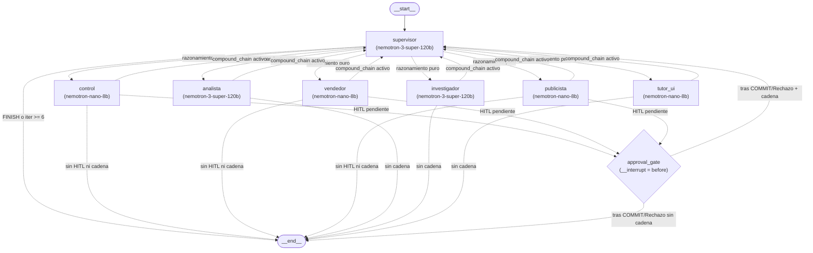

# 01 · Arquitectura y Orquestación Multiagente (LangGraph)

Este documento describe la topología exacta del grafo compilado en [agents/graph.py](../agents/graph.py), el estado maestro compartido ([schemas/state.py](../schemas/state.py)), los eventos de entrada, el encadenamiento compuesto y el mecanismo **Human-in-the-Loop (HITL)** con confirmación real en PostgreSQL.

---

## 1. Topología del Grafo LangGraph

El sistema implementa una arquitectura **Supervisor–Especialistas optimizada** con salida directa a `END` para tareas simples (evitando vueltas redundantes al supervisor) y re-entrada al supervisor únicamente cuando existe una cadena compuesta (`compound_chain`) pendiente.



### Enrutadores Condicionales (`agents/graph.py`)

| Función Router | Desde qué nodo(s) | Lógica exacta |
|---|---|---|
| `router_supervisor(state)` | `supervisor` | Lee `state["next_agent"]`. Si es uno de los 6 especialistas, salta a ese nodo; si es `"FINISH"` u otro valor, termina en `END`. |
| `router_approval(state)` | `control`, `vendedor`, `publicista` | 1) Si `pending_approval` tiene `requires_human=True` y `status=="pending"` → `approval_gate` (dispara interrupción HITL).<br>2) Si no hay HITL pero `compound_chain` tiene elementos → `supervisor`.<br>3) En otro caso → `END`. |
| `router_post_specialist(state)` | `analista`, `investigador`, `tutor_ui`, `approval_gate` | Si `compound_chain` tiene elementos → `supervisor`; de lo contrario → `END`. |

---

## 2. Estado Maestro Compartido (`OrchestratorState`)

Definido en [schemas/state.py](../schemas/state.py) como `TypedDict(total=False)`:

| Campo | Tipo | Semántica y uso en el grafo |
|---|---|---|
| `messages` | `Annotated[list, add_messages]` | Historial acumulativo de mensajes LangChain (`HumanMessage`, `AIMessage`) gestionado por el reducer `add_messages`. |
| `event_source` | `str` | Canal/evento detonante que orienta al supervisor (`chat`, `vision_api`, `ui_copilot`, `cron`, `catalog-scan`, `pos-checkout`, `receipt-ocr`). |
| `vision_payload` | `Optional[dict]` | Carga multimodal real: `{"mode", "endpoint", "file_path", "mime_type", "image_b64"}`. |
| `ui_state` | `Optional[dict]` | Estado de pantalla de pago digital para `tutor_ui`: `{"payment_method", "screen", "step", "error_code", "monto_pendiente"}`. |
| `db_evidence` | `Optional[str]` | Resumen de evidencia consultada en PostgreSQL o en el RAG (visible en `/estado`). |
| `few_shot_examples` | `Optional[list[dict]]` | Ejemplos Few-Shot recuperados dinámicamente si se inyectan en el estado. |
| `strategic_report` | `Optional[dict]` | Diccionario validado de 9 secciones generado por `investigador` (`StrategicReport`). |
| `promo_assets` | `Optional[dict]` | Paquete promocional generado por `publicista` (copy, CTA, descuento, `video_prompt` 9:16). |
| `pending_approval` | `Optional[dict]` | Payload de autorización humana (`ApprovalPayload`) que detiene el grafo en `approval_gate`. |
| `next_agent` | `Optional[str]` | Próximo especialista seleccionado por `supervisor` (o `"FINISH"`). |
| `iteration_count` | `int` | Contador estricto de pasos en el turno actual; al llegar a `6`, `supervisor` fuerza `FINISH`. |
| `compound_chain` | `Optional[list[str]]` | Cola ordenada de especialistas adicionales a ejecutar secuencialmente tras `next_agent`. |
| `errores` | `list[str]` | Registro de incidencias no fatales acumuladas durante el ciclo. |

---

## 3. Reglas de Enrutamiento y Encadenamiento Compuesto

En [agents/supervisor.py](../agents/supervisor.py):

1. **Límite duro de iteraciones:** Si `iteration_count >= 6`, el supervisor cierra inmediatamente retornando `next_agent="FINISH"` para prevenir bucles infinitos.
2. **Despacho de `compound_chain`:** Si `state["compound_chain"]` no está vacío, el supervisor extrae el primer elemento (`compound_chain.pop(0)`) y lo enruta **sin consumir una llamada extra al LLM**.
3. **Decisión estructurada pura:** Invoca `llm.with_structured_output(SupervisorDecision)` (con respaldo JSON si el modelo no soporta structured output nativo). El esquema exige:
   - `next_agent`: `Literal["control", "vendedor", "analista", "investigador", "publicista", "tutor_ui", "FINISH"]`
   - `reasoning`: justificación semántica pura.
   - `compound_chain`: únicamente los agentes **adicionales posteriores** a `next_agent` (se sanitiza automáticamente para eliminar duplicados consecutivos o repeticiones de `next_agent`).
4. **Aislamiento de contexto en especialistas:** Antes de invocar cada agente ReAct (`analista`, `control`, `vendedor`, `publicista`), el nodo filtra las trazas internas `(・_・)? [SUPERVISOR]` del historial para que el último mensaje visible sea la petición real del usuario.

---

## 4. Fuentes de Evento (`event_source`)

| `event_source` | Origen típico | Especialista esperado |
|---|---|---|
| `chat` | Texto libre en CLI (`main.py`) o `POST /orchestrate` | Determinado semánticamente por el `supervisor` según intención. |
| `vision_api` | Comando `/imagen <archivo> <catalog\|pos\|ticket>` | `vendedor` si `mode="pos"`; `control` si `mode="catalog"` o `"ticket"`. |
| `catalog-scan` | `POST /catalog-scan` | `control` (alta/verificación visual de anaquel). |
| `receipt-ocr` | `POST /receipt-ocr` | `control` (OCR de factura y clasificación contable). |
| `pos-checkout` | `POST /pos-checkout` | `vendedor` (detección visual en mostrador + cotización). |
| `ui_copilot` | Comando `/pago <metodo> <pantalla> <paso> [error]` | `tutor_ui` (asistencia CoDi/SPEI/DiMo en máx. 2 oraciones). |
| `cron` | Comando `/cron` o tarea programada | `control` (barrido real en PostgreSQL) → `publicista` si hay alertas. |

---

## 5. Ciclo Human-in-the-Loop (HITL) y `COMMIT` Real

El grafo se compila con:
```python
memory = MemorySaver()
graph = builder.compile(checkpointer=memory, interrupt_before=["approval_gate"])
```

### Flujo completo paso a paso:
1. Un agente con capacidad de escritura (`control`, `vendedor` o `publicista`) construye `pending_approval` con `requires_human=True`, `status="pending"` y `proposed_data` detallando la operación a confirmar.
2. `router_approval` dirige el flujo hacia `approval_gate`.
3. Por `interrupt_before=["approval_gate"]`, LangGraph **detiene la ejecución** y congela el estado en el checkpointer bajo `thread_id`.
4. El cliente (CLI interactivo o `POST /orchestrate/resume`) presenta el `ApprovalPayload` al operador y recoge su decisión: **Aprobar (`s`)**, **Rechazar (`n`)** o **Editar (`e`)**.
5. `resume_orchestration(thread_id, approved, correction, notes)`:
   - Actualiza `pending_approval["status"]` a `"approved"` o `"rejected"` y guarda `human_notes`.
   - Persiste el registro en `data/hitl_feedback/nemo_sft_dataset.jsonl` mediante `record_hitl_feedback()` (alimentando NeMo Customizer).
   - Ejecuta `tiendita_graph.update_state(...)` y reanuda con `tiendita_graph.invoke(None, config)`.
6. Entra a `approval_gate_node(state)`:
   - Si `status == "approved"`: llama a `_commit_approved_db_action(pending)` para ejecutar el `COMMIT` real en PostgreSQL (por ejemplo, `INSERT INTO promocion (...) VALUES (...)` para campañas aprobadas) y limpia `pending_approval = None`.
   - Si `status == "rejected"`: cancela limpiamente **sin escribir en PostgreSQL** y deja traza `[HITL RECHAZADO]`.

---

## 6. API Programática de Orquestación (`agents/graph.py`)

| Función | Firma / Propósito |
|---|---|
| `run_orchestration(...)` | Ejecución síncrona de un turno; acepta `input_text`, `thread_id`, `event_source`, `vision_payload`, `ui_state`, `provider`, `model_name`. Envuelve el turno en `override_model_context(...)`. |
| `run_orchestration_stream(...)` | Generador asíncrono (SSE) que emite eventos nodo por nodo para `POST /orchestrate/stream`. |
| `resume_orchestration(...)` | Reanuda un `thread_id` pausado en `approval_gate`, registra feedback HITL y dispara el `COMMIT` o cancelación. |
| `get_graph_state(thread_id)` | Inspecciona el snapshot real (`values` + `next`) del checkpointer para diagnóstico y comando `/estado`. |

---

## 7. Contratos de Datos Pydantic (`schemas/`)

| Módulo | Modelos clave | Uso principal |
|---|---|---|
| [schemas/state.py](../schemas/state.py) | `OrchestratorState` | Estado compartido de LangGraph. |
| [schemas/commerce.py](../schemas/commerce.py) | `Producto`, `Lote`, `ItemCarrito`, `CarritoPOS`, `ApprovalPayload` | Estructuras comerciales y contrato de pausa HITL. |
| [schemas/vision.py](../schemas/vision.py) | `CatalogScanRequest`, `POSCheckoutRequest`, `ReceiptOCRRequest` y salidas estructuradas | Contratos de los endpoints multimodales de `api.py`. |
| [schemas/ui_copilot.py](../schemas/ui_copilot.py) | `UIState`, `TutorResponse` | Validador que recorta y unifica exactamente 1–2 oraciones para `tutor_ui`. |
| [schemas/reports.py](../schemas/reports.py) | `StrategicReport` (9 campos obligatorios), `VideoPrompt` (9:16, 5s), `PromoAssets` | Salidas estructuradas de `investigador` y `publicista`. |
