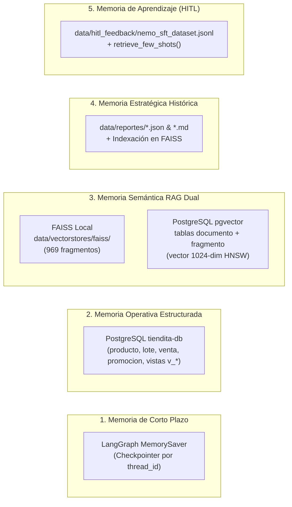

# 04 · Arquitectura de Memoria Multicapa y RAG de Pagos Digitales (CoDi, SPEI, DiMo)

Tiendita IA no depende de una única memoria plana: combina **5 capas de memoria especializadas** que cubren desde el estado instantáneo de un turno en mostrador hasta el conocimiento regulatorio oficial de Banco de México (Banxico) y el entrenamiento continuo de adaptadores LoRA.

---

## 1. Las 5 Capas de Memoria del Sistema



| Capa | Tecnología / Ubicación | Alcance | Quién la lee / escribe |
|---|---|---|---|
| **1. Conversacional / Sesión** | `MemorySaver` (`agents/graph.py`) indexado por `thread_id` | Duración del proceso; persiste historial `messages`, `db_evidence`, `pending_approval` e interrupciones HITL | Todos los nodos del grafo; inspeccionable con `get_graph_state(thread_id)` y `/estado` |
| **2. Operativa Transaccional** | PostgreSQL 16 (`tiendita-db`, `DATABASE_URL`) | Persistente en volumen Docker | `control`, `vendedor`, `analista`, `publicista`, `approval_gate` |
| **3. RAG Semántico (Pagos + Políticas)** | FAISS (`data/vectorstores/faiss/`) + `pgvector` (`documento`/`fragmento`) | Persistente en disco y BD (`969` fragmentos) | `tutor_ui`, `vendedor`, `investigador`, comando `/rag` |
| **4. Reportes Estratégicos** | `data/reportes/<timestamp>_<slug>.{json,md}` + FAISS | Persistente entre sesiones | `investigador` (`search_past_reports`, `save_and_index_report`), `GET /reports/history` |
| **5. Feedback HITL / Few-Shot** | `data/hitl_feedback/nemo_sft_dataset.jsonl` + `_FEW_SHOT_REPOSITORY` | Persistente entre sesiones | `resume_orchestration` escribe; `scripts/export_nemo_sft.py` exporta a NeMo Customizer |

---

## 2. Corpus de Pagos Digitales en México (`data/Embeddings/datos/`)

El sistema ingesta automáticamente los tres archivos precalculados del dominio de pagos digitales mexicanos:

| Archivo | Contenido | Detalles técnicos |
|---|---|---|
| `conocimiento.jsonl` | **934 fragmentos** de documentos oficiales de Banxico (Circular 14/2017 SPEI, `codi-cobro-digital.md`, `guia-experiencia-usuario-transferencias.md`, `mi-spei-transferencias-cep.md`, informes de infraestructura financiera y DiMo) | Campos: `id`, `doc`, `titulo`, `seccion`, `texto`, `fuente`, `relevancia`. Cobertura: 444 menciones SPEI, 183 CoDi, 29 DiMo. |
| `embeddings.npz` | Vectores precalculados con `nvidia/nemotron-3.5-embed-8b` | Matriz `v` de forma `(934, 4096)` `float16` L2-normalizada + `ids` + `modelo`. Persistida intacta en `data/vectorstores/faiss/pagos_precomputed_4096.faiss`. |
| `guias.json` | Guías paso a paso por pantalla (`BBVA:transferencia`, genéricas de `transferencia`, `cobro`, `pago_servicio`, `saldo`) y advertencias de seguridad (`_claves`: nunca compartir NIP/token/CVV; verificar depósito antes de entregar mercancía) | Indexadas como documentos con `fuente_tipo="guias_json"` y priorizadas en asistencia de pantalla. |

---

## 3. Enriquecimiento de Metadatos y Sincronización Dual ([tools/rag_nemo.py](../tools/rag_nemo.py))

Durante la carga (`_construir_documentos_pagos()`), cada fragmento recibe metadatos estructurados que permiten filtrado preciso sin depender de heurísticas frágiles en los agentes:

- **`metodo_pago` / `metodos_pago`:** `'codi'`, `'spei'`, `'dimo'` o `'general'`.
- **`pantalla` / etapa:** `'cobro_qr'`, `'transferir'`, `'monto_concepto'`, `'confirmacion'`, `'comprobante'`, `'rechazo_error'`, o la pantalla exacta de `guias.json`.
- **`codigos_error`:** `'formato_invalido'`, `'firma_invalida'`, `'saldo_insuficiente'`, `'cuenta_invalida'`, `'limite_excedido'`, `'rechazo_pago'`, `'cep_no_encontrado'`, `'timeout_retencion'`.
- **`fuente_tipo`:** `'guias_json'`, `'conocimiento_jsonl'`, `'politica_base'`, `'strategic_report'`.

### Alineación Vectorial FAISS ↔ PostgreSQL `pgvector` (`vector(1024)`)
1. **Índice FAISS activo (`data/vectorstores/faiss/index.faiss` + `index.pkl`):** generado con `HuggingFaceEmbeddings("sentence-transformers/all-MiniLM-L6-v2", normalize_embeddings=True)` usando `DistanceStrategy.MAX_INNER_PRODUCT` (similitud coseno exacta en `[0.0, 1.0]`). Se reconstruye solo si cambia `_FAISS_INDEX_VERSION` o no existe `manifest_pagos.json`.
2. **Respaldo de vectores precalculados 4096-dim:** `data/vectorstores/faiss/pagos_precomputed_4096.faiss` + `pagos_precomputed_meta.json` conserva los 934 vectores originales de `nvidia/nemotron-3.5-embed-8b`.
3. **Sincronización con `pgvector` (`sincronizar_pgvector()`):**
   - La tabla `fragmento` en `tiendita-db` define `embedding vector(1024) NOT NULL` con índice HNSW (`vector_cosine_ops`).
   - `_pad_to_pgvector_dim()` aplica *zero-padding* sobre vectores unitarios de 384 dimensiones hasta 1024 dimensiones. Matemáticamente, añadir ceros a vectores L2-normalizados preserva **exactamente** la norma unitaria ($\|u\| = \|v\| = 1$) y el producto interno/similitud coseno ($1 - (u \Leftrightarrow v)$), permitiendo poblar los **13 documentos y 969 fragmentos** en ~2.5 s y consultar `pgvector` con idéntica precisión.

---

## 4. Pipeline de Recuperación (`buscar_guia_pago` y `buscar_rag_pagos`)

```text
Consulta + metodo_pago + pantalla
        │
        ▼
[1] Búsqueda coseno amplia en FAISS (fetch_k = max(top_k*8, 24))
        │
        ▼
[2] Filtrado por metodo_pago (codi/spei/dimo) + boost por pantalla y guias_json
        │
        ▼
[3] Reranking semántico con NVIDIA NVIDIARerank (nvidia/nv-rerankqa-mistral-4b-v3)
    └─ Si NVIDIA_API_KEY no tiene acceso/falla -> marca fallback de sesión y conserva score coseno FAISS
        │
        ▼
[4] Retorna list[dict] con {id, doc, titulo, seccion, metodo_pago, pantalla, codigos_error, score, motor, texto}
```

### Cómo consumen este RAG los agentes y el CLI:
- **`tutor_ui`:** llama a `consultar_guia_pago_digital(metodo_pago, pantalla, error_code, duda)` antes de redactar sus 2 oraciones accionables, y registra en `db_evidence` los documentos y scores exactos.
- **`vendedor`:** usa `consultar_reglas_pago_pos` y `checkout_cart` para verificar límites sin comisión de CoDi/DiMo y requisitos de SPEI antes de cerrar la venta.
- **CLI `/rag <consulta>`:** invoca `buscar_rag_pagos()` (soporta filtro opcional `codi:`, `spei:`, `dimo:`), verifica sincronización de `pgvector` y muestra una tabla Rich con método, documento/sección, score y extracto.
