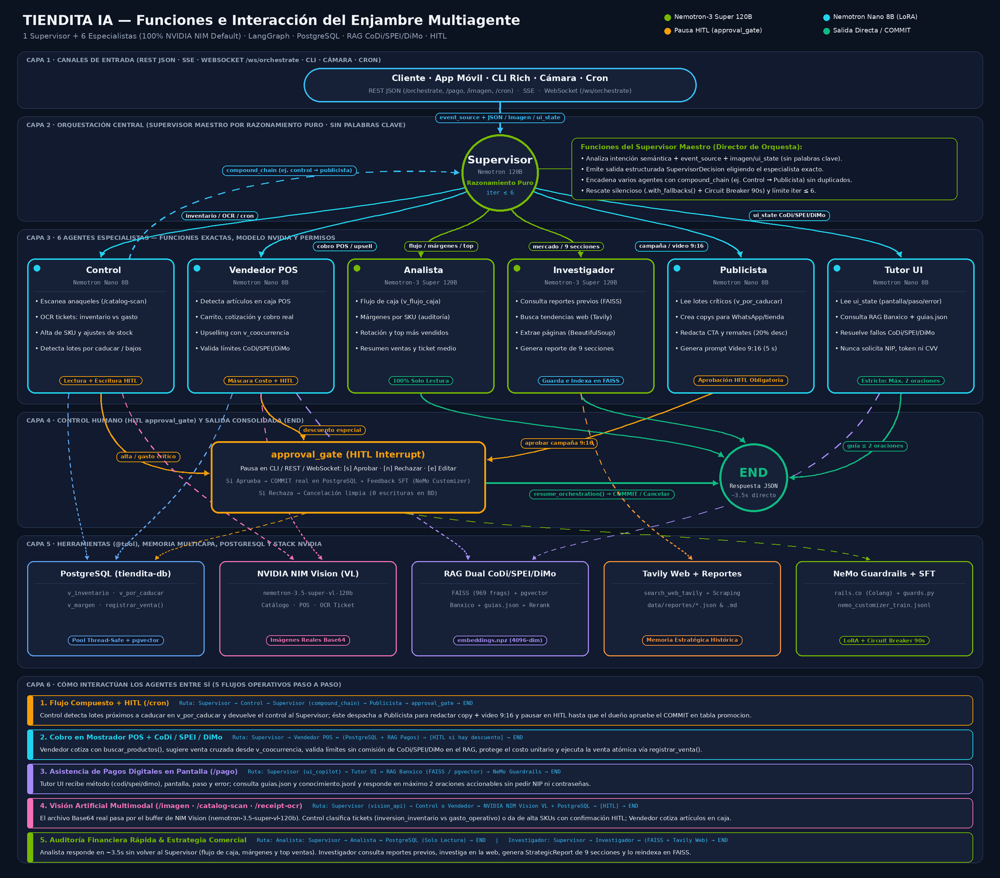
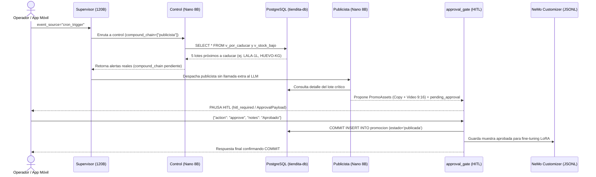
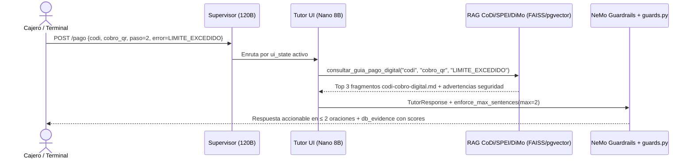

# 08 · Diagramas de Interacción y Flujo Operativo del Enjambre

Este documento muestra visualmente cómo interactúan los **7 agentes**, las **acciones sobre cada arista**, el control humano (**HITL**) y las capas de **PostgreSQL, RAG CoDi/SPEI/DiMo, NIM Vision y NeMo**.

> **Imagen estática de alta resolución guardada en el repositorio:**
> - PNG (2100×1410): [`docs/diagrama_agentes_tiendita_ia.png`](./diagrama_agentes_tiendita_ia.png)
> - SVG vectorial: [`docs/diagrama_agentes_tiendita_ia.svg`](./diagrama_agentes_tiendita_ia.svg)
> - Regenerar con: `uv run python scripts/generar_imagen_grafo.py`

---

## 1. Mapa Completo de Agentes, Acciones (Aristas) y Subsistemas

```mermaid
flowchart TD
    %% Capa 1: Canales
    Cliente(["Cliente / App Móvil / CLI / Cámara / Cron"])

    %% Capa 2: Supervisor (círculo)
    Supervisor(("Supervisor Maestro\nNemotron-3 Super 120B\nRazonamiento Puro"))

    %% Capa 3: 6 Especialistas (rectángulos)
    Control["Control\nNemotron Nano 8B\nInventario · OCR · Caducidad"]
    Vendedor["Vendedor POS\nNemotron Nano 8B\nCarritos · Upsell · CoDi/SPEI"]
    Analista["Analista Financiero\nNemotron-3 Super 120B\nSolo Lectura"]
    Investigador["Investigador\nNemotron-3 Super 120B\nWeb + Reporte 9 Secciones"]
    Publicista["Publicista\nNemotron Nano 8B\nCopy · CTA · Video 9:16"]
    TutorUI["Tutor UI\nNemotron Nano 8B\nPagos MX · Máx. 2 oraciones"]

    %% Capa 4: HITL y Salida
    HITL{"approval_gate\nInterrupción HITL\n[Aprobar / Rechazar / Editar]"}
    END(["END\nRespuesta JSON / WS / CLI"])

    %% Capa 5: Subsistemas
    PG[("PostgreSQL tiendita-db\nv_* · registrar_venta() · pgvector")]
    Vision["NVIDIA NIM Vision VL\nnemotron-3.5-super-vl-120b"]
    RAG[("RAG Dual CoDi/SPEI/DiMo\nFAISS 969 frags + pgvector")]
    Web["Tavily Web + Scraping\ndata/reportes/"]
    NeMo["NeMo Guardrails (Colang)\n+ NeMo Customizer (SFT/LoRA)"]

    %% Aristas de entrada y enrutamiento
    Cliente -->|"event_source + mensaje/imagen/ui_state"| Supervisor
    Supervisor -->|"catalog-scan / receipt-ocr / cron"| Control
    Supervisor -->|"pos-checkout / cobro mostrador"| Vendedor
    Supervisor -->|"flujo caja / márgenes / rotación"| Analista
    Supervisor -->|"estudio mercado / estrategia"| Investigador
    Supervisor -->|"campaña rescate / video 9:16"| Publicista
    Supervisor -->|"ui_state CoDi / SPEI / DiMo"| TutorUI

    %% Encadenamiento compuesto
    Control -.->|"compound_chain (si hay alertas)"| Supervisor

    %% Rutas hacia HITL o salida directa
    Control -->|"alta catálogo / gasto crítico"| HITL
    Vendedor -->|"descuento especial"| HITL
    Publicista -->|"aprobar publicación campaña"| HITL

    Control -.->|"consulta sin escritura"| END
    Vendedor -.->|"venta normal sin descuento"| END
    Analista -->|"respuesta directa (Solo Lectura)"| END
    Investigador -->|"reporte 9 secciones indexado"| END
    TutorUI -->|"guía ≤ 2 oraciones"| END

    HITL -->|"resume_orchestration(): COMMIT o Cancelar"| END

    %% Conexiones a herramientas y memoria
    Control -.->|"SQL inventario / lotes"| PG
    Control -.->|"Base64 catálogo / ticket"| Vision
    Vendedor -.->|"buscar_productos / registrar_venta()"| PG
    Vendedor -.->|"Base64 mostrador"| Vision
    Vendedor -.->|"reglas/límites CoDi/SPEI/DiMo"| RAG
    Analista -.->|"vistas v_margen / v_flujo_caja"| PG
    Investigador -.->|"reportes previos + políticas"| RAG
    Investigador -.->|"búsqueda web + scraping"| Web
    Publicista -.->|"v_por_caducar"| PG
    TutorUI -.->|"consultar_guia_pago_digital()"| RAG
    HITL -.->|"COMMIT tabla promocion / BD"| PG
    HITL -.->|"record_hitl_feedback() → SFT"| NeMo
    Vendedor -.->|"prevent_cost_leakage()"| NeMo
    TutorUI -.->|"enforce_max_sentences(2)"| NeMo
```

---

## 2. Secuencia de Operación: Flujo Compuesto con HITL (`/cron` o WebSocket)

---

## 3. Secuencia de Operación: Tutor UI de Pagos Digitales (`POST /pago`)

