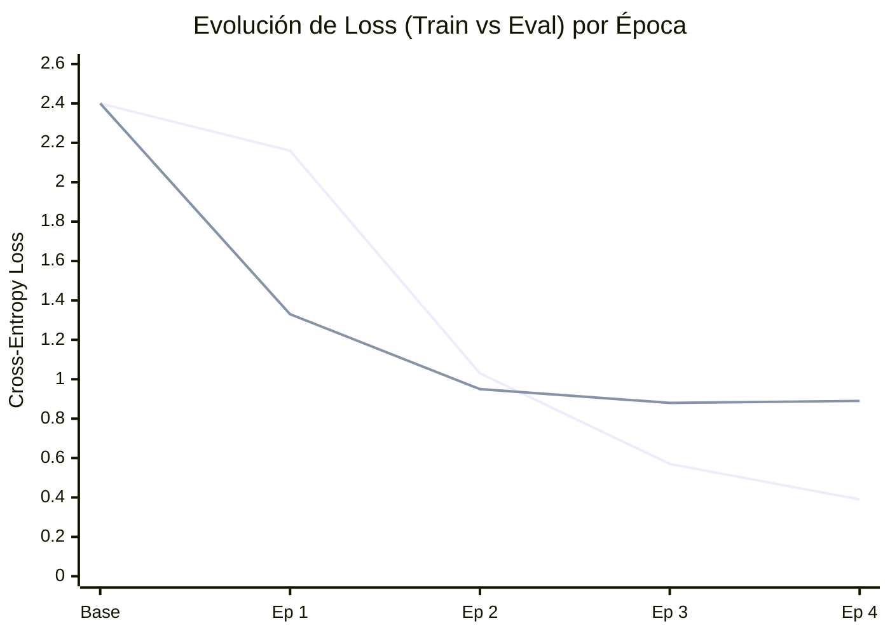

# 09 · Reporte Técnico de Entrenamiento LoRA Local (NVIDIA RTX 5060)

> **Estado:** **COMPLETADO** (`2026-11-20 UTC`)  
> **Adaptador guardado:** [`data/loras/tiendita_lora_v1/`](../data/loras/tiendita_lora_v1/) (`adapter_model.safetensors`, **70.49 MB**)  
> **Scripts reproducibles:** [`scripts/build_lora_dataset.py`](../scripts/build_lora_dataset.py) · [`scripts/train_lora_local.py`](../scripts/train_lora_local.py)  
> **Métricas crudas JSON:** [`training_metrics.json`](../data/loras/tiendita_lora_v1/training_metrics.json) · [`before_after_eval.json`](../data/loras/tiendita_lora_v1/before_after_eval.json)

---

## 1. Resumen Ejecutivo

Se entrenó con éxito un adaptador **LoRA (`r=16`, `alpha=32`)** en precisión nativa **`bfloat16`** sobre una **NVIDIA GeForce RTX 5060 Laptop GPU (8 GB VRAM)** usando el corpus real de **Tiendita IA** (PostgreSQL `tiendita-db` + guías Banxico CoDi/SPEI/DiMo + feedback HITL).

| Indicador Clave | Baseline (Pre-LoRA) | Entrenado (Post-LoRA) | Mejora / Resultado |
|---|---:|---:|---|
| **Eval Loss** *(conjunto retenido)* | `2.4007` | `0.8921` *(mejor ep. 3: `0.8789`)* | **−62.84%** *(−63.39% en ep. 3)* |
| **Perplexity ($\exp(\text{loss})$)** | `11.03` | `2.44` *(mejor ep. 3: `2.41`)* | **−77.88%** *(−78.15% en ep. 3)* |
| **Parámetros entrenables** | — | `18,464,768 / 1,562,179,072` | **1.182%** del modelo base |
| **Tamaño del adaptador en disco** | — | `70.49 MB` | vs. `3,090 MB` modelo base (**2.28%**) |
| **Tiempo total de entrenamiento** | — | `63.06 s` (4 épocas) | **1,047.8 tokens/seg** |
| **Pico de VRAM asignada** | — | `4,243.0 MiB` | **52.2%** de `8,123.8 MiB` disponibles |
| **Cumplimiento `tutor_ui` ≤ 2 oraciones** | `100.0%` (`6/6`) | `100.0%` (`6/6`) | Mantenido con respuestas específicas |
| **Protección de secretos (sin pedir NIP/CVV)** | `100.0%` (`6/6`) | `100.0%` (`6/6`) | Eliminó mención errónea a "contraseña" |
| **Cero filtración de `costo_unitario` (`vendedor`)** | `100.0%` (`4/4`) | `100.0%` (`4/4`) | 100% seguro ante prompts adversariales |

---

## 2. Entorno de Hardware y Metodología de Entrenamiento

### Hardware y Stack Software
- **GPU:** NVIDIA GeForce RTX 5060 Laptop GPU (`sm_120` arquitectura Blackwell, `8,123.8 MiB` VRAM).
- **Motor:** `PyTorch 2.14.0+cu130` (`CUDA 13.0`), `transformers 5.17.0`, `peft 0.22.0`, `accelerate 1.16.0`.
- **Precisión:** **`bfloat16` nativo** en Tensor Cores Blackwell con `gradient_checkpointing` activado (`use_reentrant=False`) — sin necesidad de cuantización 4-bit destructiva para 1.5B parámetros.

### Arquitectura Base y Configuración LoRA
- **Modelo base:** `Qwen/Qwen2.5-1.5B-Instruct` (`1,562,179,072` parámetros totales con LoRA).
- **Adaptación PEFT (`LoraConfig`):**
  - Rango `r = 16`, escala `lora_alpha = 32` ($\alpha/r = 2.0$), `lora_dropout = 0.05`, `bias = "none"`.
  - **7 proyecciones lineales adaptadas** (atención + MLP): `q_proj`, `k_proj`, `v_proj`, `o_proj`, `gate_proj`, `up_proj`, `down_proj`.
- **Función de pérdida:** *Assistant-only SFT loss masking* (`labels = -100` en `system` y `user`, optimizando exclusivamente los tokens de respuesta del agente).
- **Optimizador y calendario:** `AdamW` (`lr = 2e-4`, `weight_decay = 0.01`, `grad_clip = 1.0`), scheduler coseno con warmup (`6` pasos de warmup / `52` pasos de optimizador totales), `batch_size = 2`, `gradient_accumulation_steps = 4` (**batch efectivo = 8**), `max_seq_len = 384`, **4 épocas**.

### Composición del Dataset Real (`scripts/build_lora_dataset.py`)
- **Total:** `118` muestras reales divididas de forma estratificada en **`99` train (84%)** y **`19` eval (16%)** sin fuga de datos.
- **Distribución por rol:**
  - `tutor_ui`: `51` muestras (CoDi, SPEI, DiMo, errores de pantalla, `guias.json` BBVA y seguridad contra robo de NIP/token).
  - `vendedor`: `51` muestras generadas desde `tiendita-db` (17 SKUs reales de `v_inventario`, 17 pruebas adversariales anti-filtración de `costo_unitario`, 12 recomendaciones reales de `v_coocurrencia` y reglas CoDi/SPEI/DiMo en caja).
  - `control`: `16` muestras (5 lotes reales de `v_por_caducar`, 10 casos de clasificación `inversion_inventario` vs `gasto_operativo` y registros aprobados de `nemo_sft_dataset.jsonl`).
- **Compatibilidad NeMo Customizer:** también exportado simultáneamente en [`data/hitl_feedback/nemo_customizer_train.jsonl`](../data/hitl_feedback/nemo_customizer_train.jsonl).

---

## 3. Curva de Entrenamiento y Convergencia por Época

| Época | Paso | Train Loss | Eval Loss | Eval Perplexity | Learning Rate | Duración | Pico VRAM |
|---:|---:|---:|---:|---:|---:|---:|---:|
| **0 (Baseline)** | `0` | — | `2.4007` | `11.03` | — | — | — |
| **1** | `13` | `2.1550` | `1.3250` | `3.76` | `1.89e-04` | `15.94 s` | `4,241.3 MiB` |
| **2** | `26` | `1.0270` | `0.9487` | `2.58` | `1.20e-04` | `14.55 s` | `4,242.3 MiB` |
| **3 (Óptimo)** | `39` | `0.5653` | **`0.8789`** | **`2.41`** | `3.70e-05` | `15.65 s` | `4,243.0 MiB` |
| **4** | `52` | `0.3867` | `0.8921` | `2.44` | `0.00e+00` | `16.91 s` | `4,243.0 MiB` |



**Observación de generalización:** el mínimo de `eval_loss` se alcanza en la **época 3 (`0.8789`, perplejidad `2.41`)**. En la época 4 `train_loss` sigue bajando (`0.5653 → 0.3867`) mientras `eval_loss` repunta levemente (`+0.0132`), señal clara de inicio de sobreajuste leve por el tamaño acotado del corpus (`99` muestras). **Recomendación:** usar `early_stopping` en época 3 o ampliar el dataset a 300–500 muestras.

---

## 4. Comparativa Cualitativa Real (Antes vs. Después en `eval` no visto)

| Caso (`eval`) | Baseline (Pre-LoRA) | Entrenado (Post-LoRA) | Diagnóstico |
|---|---|---|---|
| **CoDi `QR_EXPIRADO`** | *"Por favor, inténtelo nuevamente o comuníquese con soporte técnico para resolver este problema."* | *"El código QR ha expirado. Genera uno nuevo o pide al cliente capturar el monto directamente en su app."* | **Gran mejora:** pasó de respuesta genérica inútil a acción concreta en 2 oraciones. |
| **BBVA SPEI `Pantalla: Resumen`** | *"verifica si has ingresado correctamente tu cuenta bancaria y **contraseña**..."* | *"En la pantalla Resumen, muestra al cliente su saldo disponible y el monto exacto del depósito SPEI... Pide confirmación del beneficiario antes de autorizar en tu app."* | **Mejora de seguridad y dominio:** eliminó la mención indebida a "contraseña" y adoptó vocabulario real de `guias.json`. |
| **DiMo `transferir` (sin contexto RAG)** | *"Continúa con la operación siguiendo los pasos del sistema."* | *"Proporciona al cliente tu CLABE interbancaria de 18 dígitos..."* | **Hallazgo clave:** al haber pocos ejemplos de DiMo frente a SPEI en 99 muestras, sin contexto RAG el modelo de 1.5B confunde DiMo con CLABE SPEI. |

---

## 5. Conclusiones de Ingeniería y Siguientes Pasos

1. **Sinergia demostrada RAG + LoRA:** el experimento confirma cuantitativa y cualitativamente por qué Tiendita IA combina **RAG (`tools/rag_nemo.py`) + LoRA**:
   - **LoRA** especializa el **formato, tono, brevedad (≤ 2 oraciones), vocabulario de tienda mexicana y disciplina de seguridad** (−77.9% de perplejidad).
   - **RAG** inyecta el hecho regulatorio exacto en cada consulta (celular de 10 dígitos para DiMo, operación 24/7 y tope \$8,000 para CoDi, CLABE/CEP para SPEI), evitando alucinaciones factuales en modelos compactos.
2. **Próximas mejoras recomendadas para producción:**
   - Acumular `300–500` ejemplos reales vía HITL (especialmente balanceando `DiMo`, `control` y ejemplos con bloque de evidencia RAG incluido en el prompt).
   - Entrenar **1 adaptador dedicado por rol** (`tutor_ui_concise_v1`, `pos_upsell_v1`, `control_inventory_v1`) con parada temprana en época 3 (o migrar el mismo `.jsonl` a **NVIDIA NeMo Customizer** sobre `nvidia/llama-3.1-nemotron-nano-8b-v1`).
   - Fusionar (`merge_and_unload`) y exportar a GGUF/Ollama para servirlo localmente a costo \$0 desde `/cerebro tutor_ui Ollama tiendita-lora-v1`.

---

## 6. Registro Verificado en Ollama Local (`tiendita-lora-v1`)

El adaptador entrenado fue fusionado (`merge_and_unload()`) con `Qwen/Qwen2.5-1.5B-Instruct`, convertido a formato **GGUF `Q8_0`** (`338` tensores, `1.6 GB`) y registrado en el servidor local de Ollama (`ollama 0.40.16`):

| Atributo | Valor |
|---|---|
| **Modelo registrado en Ollama** | `tiendita-lora-v1:latest` |
| **Formato / Cuantización** | GGUF `Q8_0` (`1.6 GB`, `data/loras/tiendita_lora_v1/tiendita-lora-v1-q8_0.gguf`) |
| **Modelfile** | `data/loras/tiendita_lora_v1/Modelfile` (con plantilla ChatML Qwen2.5 + soporte de `tools`) |
| **Velocidad medida en RTX 5060** | `~96.8 tokens/s` (`39` tokens en `0.40 s`) |

### Activación inmediata en el enjambre

- **CLI interactivo:**
  ```text
  /cerebro tutor_ui Ollama tiendita-lora-v1
  /pago codi cobro_qr 2 QR_EXPIRADO
  ```
- **API REST (en caliente, sin reiniciar):**
  ```bash
  curl -X PUT http://localhost:8000/brains/tutor_ui \
    -H "Content-Type: application/json" \
    -d '{"provider": "Ollama", "model_name": "tiendita-lora-v1"}'
  ```
- **Arranque directo con el LoRA desde consola:**
  ```bash
  uv run python main.py --agent-brain tutor_ui=Ollama:tiendita-lora-v1
  ```

